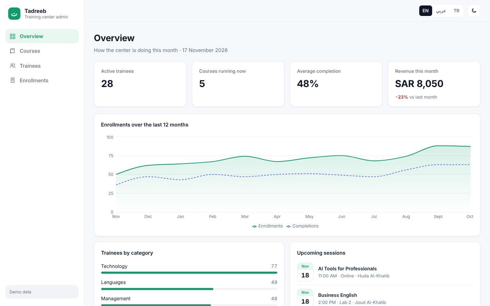
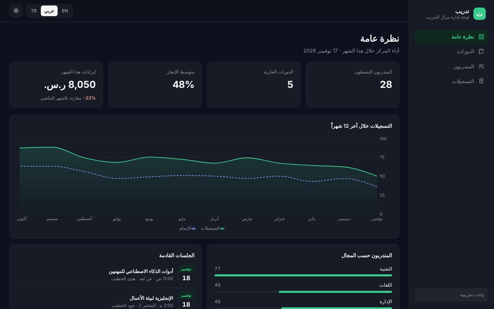
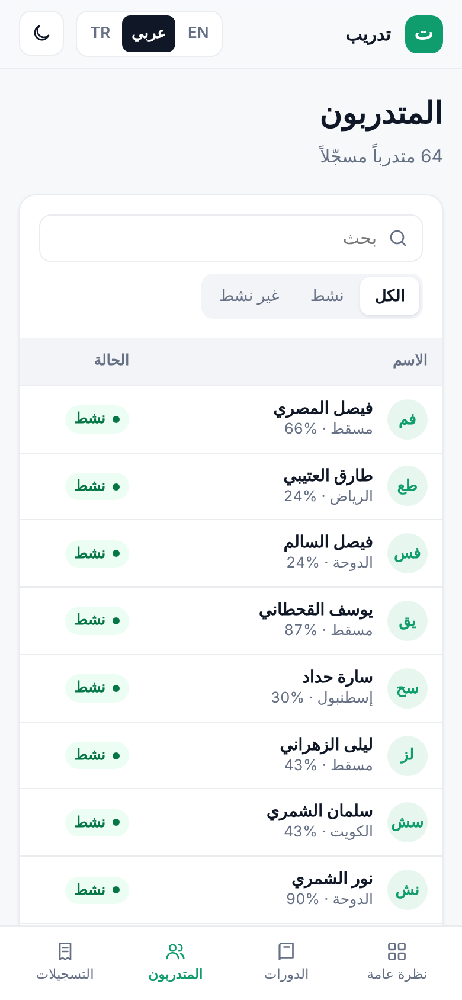
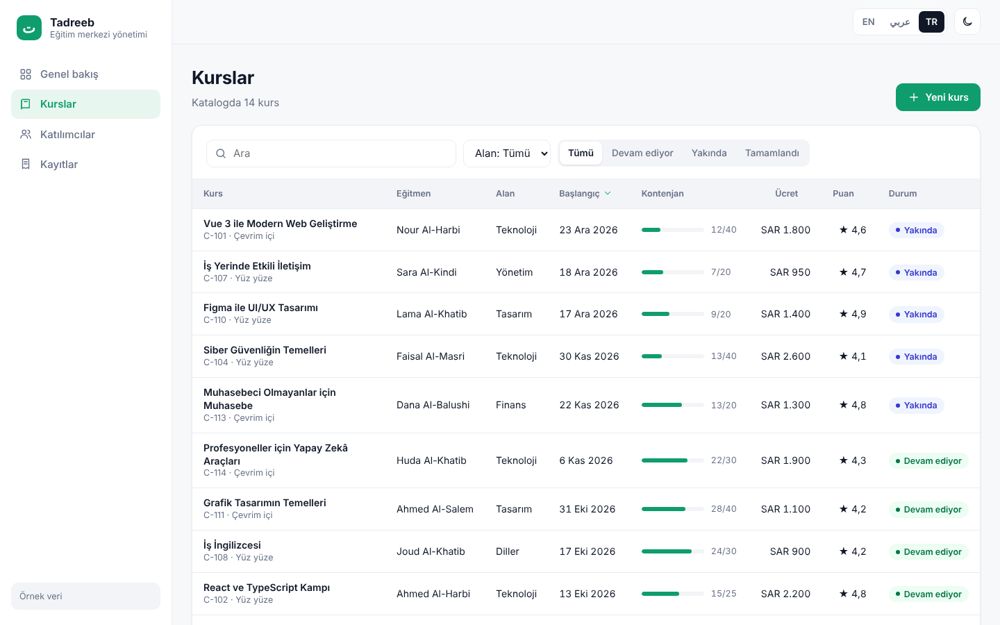

# Tadreeb · Training Center Dashboard

An admin dashboard for a training center, built with **React + TypeScript**. It runs in **English, Arabic (full RTL) and Turkish**, with light and dark themes and a layout that works on phones.

**Live demo:** https://yaman-mando.github.io/tadreeb-dashboard/
Open a specific language: [English](https://yaman-mando.github.io/tadreeb-dashboard/?lang=en) · [العربية](https://yaman-mando.github.io/tadreeb-dashboard/?lang=ar) · [Türkçe](https://yaman-mando.github.io/tadreeb-dashboard/?lang=tr)



| Arabic, dark theme | Mobile (Arabic) |
|---|---|
|  |  |



## Features

- **Overview:** KPIs (active trainees, running courses, average completion, monthly revenue with month-over-month change), a 12-month enrollments chart, trainees by category, upcoming sessions and the fullest courses.
- **Courses:** search, category and status filters, sortable columns, seat occupancy bars, and a **New course** form that accepts a title in each language.
- **Trainees:** search, active/inactive filter, progress per trainee and last activity.
- **Enrollments:** collected vs. pending payments, status filter and paging.
- **Three languages with real RTL:** the layout is written with CSS logical properties (`margin-inline`, `inset-inline-start`, …), so Arabic mirrors without a separate stylesheet. Charts flip their axes in RTL, and numbers, dates and currency are formatted with `Intl` for each locale.
- **Light and dark themes** from a single set of CSS tokens; the charts read the same tokens so they switch too.
- **Responsive:** sidebar on desktop, bottom tab bar on mobile, and tables that hide secondary columns on small screens.
- **Accessible:** semantic tables with `aria-sort`, a native `<dialog>` for the form, keyboard focus styles and `prefers-reduced-motion` support.

## Tech stack

React 18 · TypeScript · Vite · Recharts · CSS (no UI framework) · GitHub Actions → GitHub Pages

## Project structure

```
src/
  i18n/          messages for en / ar / tr and the I18n context (formatting helpers)
  data/mock.ts   seeded sample data, so every visit shows the same center
  components/    DataTable (sorting + paging), Badge, Progress, Card, Segmented, icons
  pages/         Overview, Courses, Trainees, Enrollments
  hooks.ts       theme, hash routing, theme-aware chart colors
```

## Run locally

```bash
npm install
npm run dev      # http://localhost:5173
npm run build    # production build in dist/
```

The data is generated sample data; no backend is needed.

---

Built by **Yaman Mando**, Senior Frontend Developer · [Portfolio](https://yaman-mando.hatchable.site) · [LinkedIn](https://linkedin.com/in/yaman-mando)
